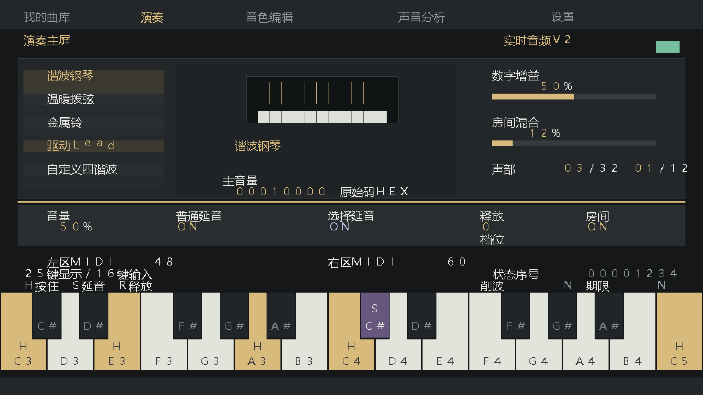
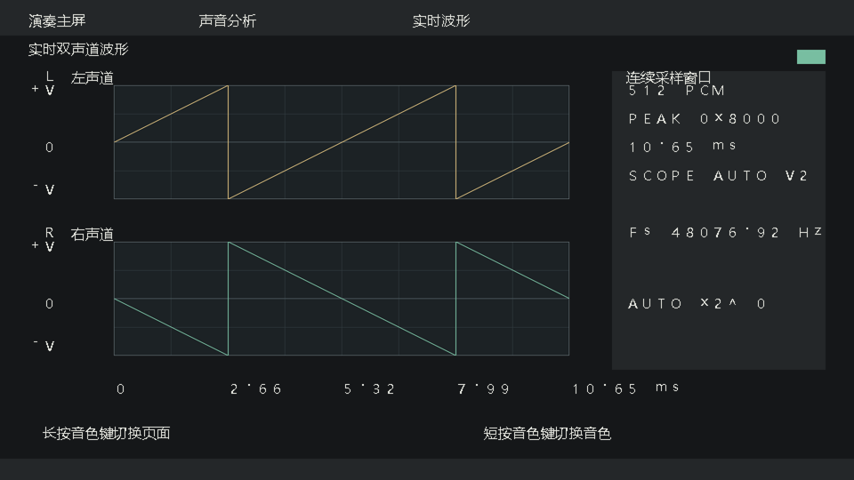

# 交付版构建记录

清除未使用的旧采样模块后，Gowin实际重新综合/PnR。当前板卡功能反馈范围见BOARD_TEST_ZH.md。

| 项目 | 实际结果 |
|---|---|
| Logic | 28254/59904 |
| Register | 13947/60780 |
| BSRAM | 83/118 |
| DSP | 27.5/118 |
| I/O Port | 26/297 |
| PLLA | 1/8 |
| PRIMARY | 8/8 |
| LW | 8/8 |
| 50MHz 域 Fmax | 51.858MHz |
| 150MHz 域 Fmax | 151.004MHz |
| Setup/Hold | 0/0 |
| 最小setup余量 | 0.044ns |

当前构建固件 SHA-256：`1289e561feab0fbab8ba2a8e6b4ba6a367b51bbc57e422d56a074ffb5126ca84`。仅记录指纹，Git不含.fs；队友本地构建后重新核对。

用户反馈对应固件：`cb44e5e143be0a8527a31648ca94006d21f5a7ef8a1479ff718b3dd6d1231086`。

本轮清理版与用户反馈版固件哈希不同，需补一次SRAM功能回归；不将旧板测自动扩大为新固件通过。

警告：

- WARN  (PR1014) : Generic routing resource will be used to clock signal 'sys_clk_d' by the specified constraint. And then it may lead to the excessive delay or skew

像素时序余量较小，新增模块必须重新做整机STA。

仿真预览使用人工注入的RTL测试样本，不是板卡照片。

